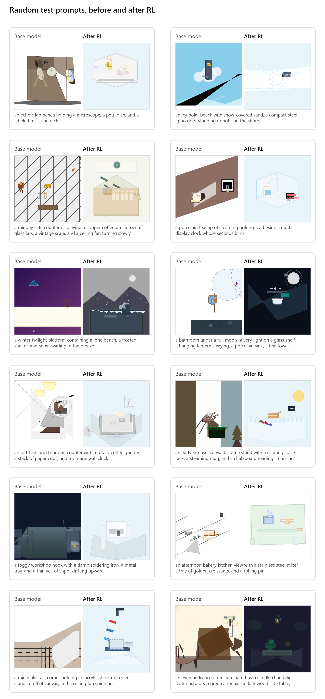

# Isometric Scenes

RL post-training of [Qwen3.5-4B](https://huggingface.co/Qwen/Qwen3.5-4B) to write animated isometric SVG scenes of places and objects.

- Environment: [najmulhasan-code/isometric-scenes](https://app.primeintellect.ai/dashboard/environments/najmulhasan-code/isometric-scenes) on the Prime Intellect Environments Hub
- Model: [najmulhasan/qwen3.5-4b-isometric-scenes-lora](https://huggingface.co/najmulhasan/qwen3.5-4b-isometric-scenes-lora)
- Dataset: [najmulhasan/isometric-scenes](https://huggingface.co/datasets/najmulhasan/isometric-scenes)

https://github.com/user-attachments/assets/4612843a-91f4-4096-815a-66bd7148d020

Selected examples from the final evaluation, with the same prompt and seed for both models. The figure below is a random sample of test prompts without distractors.



## Results

Both models answered each test prompt 4 times with the same seeds. The evaluation judge, `google/gemini-3.1-pro-preview`, which was not used in training, scored the answers.

| Prompts | Base | RL | Difference (95% CI) |
|---|---|---|---|
| Test (240) | 0.078 | 0.489 | +0.411 [0.387, 0.435] |
| Held-out category, `space` (one category, 120) | 0.082 | 0.561 | +0.479 [0.448, 0.511] |

Two RL answers on test could not be scored and are left out. Counting them as 0 gives +0.409 [0.385, 0.432].

In a blind pairwise comparison by the author on 50 test prompts, the RL answer was preferred 40 times and the base answer 6 times, with 4 ties (win rate 0.87 excluding ties, Wilson 95% CI [0.74, 0.94]). On the 30 pairs where both answers reached the judge, the counts were 22, 5 and 3 (0.81 [0.63, 0.92]).

Under the training judge, `google/gemma-3-27b-it`, the gain on test is +0.56 instead of +0.41. The difference is 0.15 [0.12, 0.18] on test and 0.09 [0.04, 0.14] on `space`. Gemma is also more lenient overall (base 0.25 against 0.08), and part of the larger gain may come from optimising against it.

The [model card](https://huggingface.co/najmulhasan/qwen3.5-4b-isometric-scenes-lora) gives the details, and [`analysis/`](analysis/) reproduces every evaluation number.

## Method

The model was trained with prime-rl and LoRA (rank 32) for 150 steps of 128 rollouts (16 prompts, 8 answers each) on 2 × H100. The reward first runs code checks: the answer must be one valid, safe SVG that renders to a non-blank frame. A code check for motion and a vision judge's yes/no answers about the rendered frames are then averaged, and a figure seen by the judge scores 0; see the [environment README](environments/isometric_scenes/README.md). The checkpoint was chosen on the validation split. It was the last one, step 150, which had the highest validation reward.

## Reproduce

```
git clone https://github.com/najmulhasan-code/isometric-scenes
```

Each folder's README gives the commands.

1. [`prompt_data/`](prompt_data/) builds the prompt dataset.
2. [`judge_selection/`](judge_selection/) probes the candidate judges.
3. [`environments/isometric_scenes/`](environments/isometric_scenes/) defines the task and the reward.
4. [`training/`](training/) runs training and the final evaluation.
5. [`analysis/`](analysis/) computes the results and draws the figures.

## Limitations

- Neither judge was checked against human labels, and the training judge scores both models far higher than the evaluation judge.
- The evaluation judge is a preview API model, so rescoring later may give different scores.
- Few answers are isometric: 10% of the RL model's answers that reached the judge on test, up from 2%.
- RL did not clearly reduce figures on distractor prompts. On test, 27 base and 29 RL answers were judged to show one. The share among judged answers fell from 35% to 19% because about the same number showed a figure while twice as many RL answers reached the judge.
- The blind comparison had a single rater, the author, and the RL outputs have a recognisable style, so the blinding is weak.
- The held-out result covers one category, and the test prompts come from the same generator as the training prompts.
- The only baseline is the base model under the same system prompt with thinking off. Thinking on, prompt tuning, supervised fine-tuning and larger models were not compared.
- There was a single training run, so the intervals cover prompt sampling only.
- Longer training and output diversity were not examined.

## Citation

```bibtex
@misc{hasan2026isometricscenes,
  author = {Najmul Hasan},
  title = {Isometric Scenes: RL post-training Qwen3.5-4B to write animated isometric SVG},
  year = {2026},
  url = {https://github.com/najmulhasan-code/isometric-scenes}
}
```

## License

The code and the adapter are released under [Apache-2.0](LICENSE). The dataset, including its copy in `environments/isometric_scenes/isometric_scenes/data/`, is released under CC BY 4.0.
